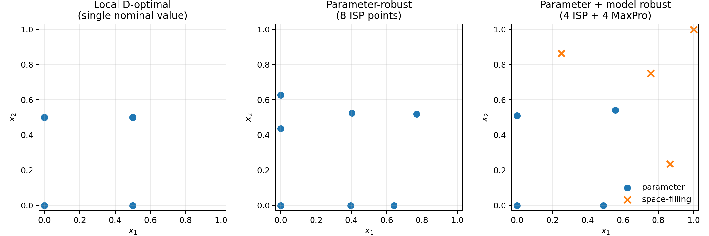
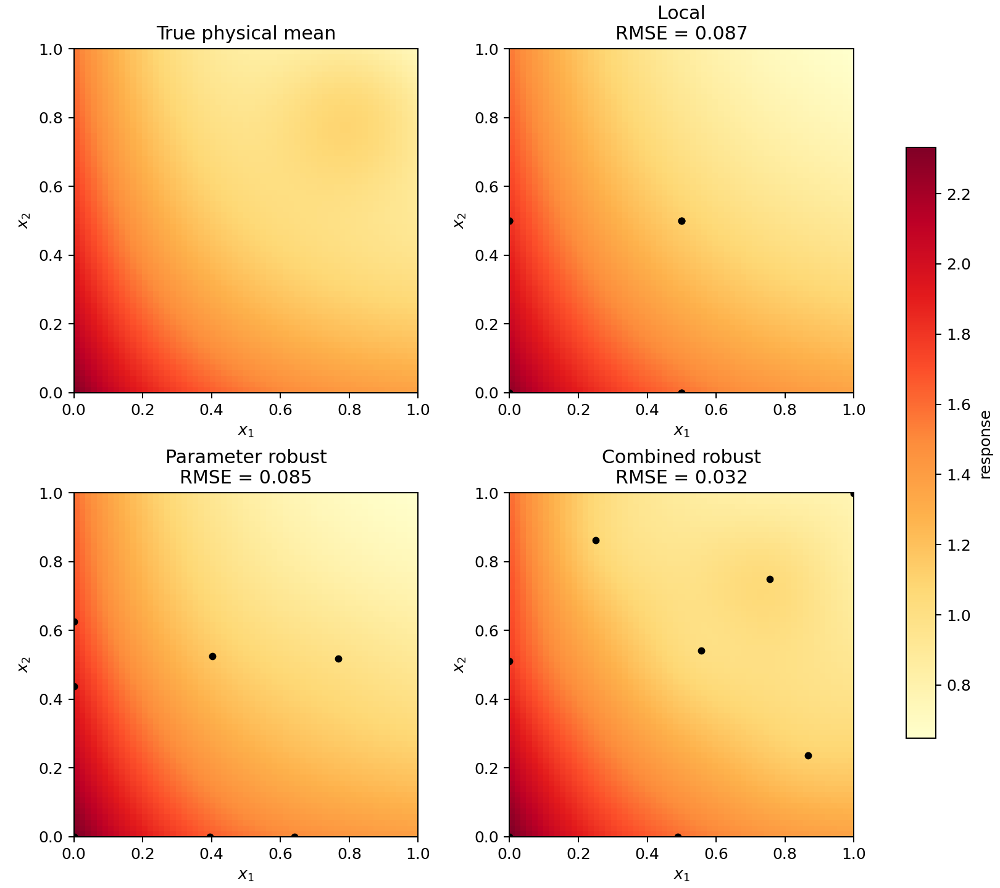

# Robust model calibration

A Python experiment based on Chapter 9.2 of V. Roshan Joseph's
*Experimental Design for Data Science and Engineering*.

The question is whether a design that estimates calibration parameters well also
predicts the physical response well when the model is missing a local effect.
Three designs are compared, each with eight observations:

| Design | Allocation |
|---|---|
| Local D-optimal | Four locations, measured twice each |
| Parameter-robust | Eight importance support points (ISP); repeats allowed |
| ISP + MaxPro | Four ISP points and four sequential MaxPro points |



## Run

Use Python 3.10 or later. From the repository root:

```bash
python3 -m venv .venv
source .venv/bin/activate
python -m pip install -r requirements.txt
jupyter lab simulation.ipynb
```

On Windows, activate with `.venv\Scripts\activate` instead.
Run the notebook from top to bottom. Restart from Step 0 when rerunning it so the
random draws stay reproducible. To run without opening plots:

```bash
MPLBACKEND=Agg python simulation.py
```

Both versions save figures and CSV files in `results/`. The notebook has no saved
outputs; the committed figures and CSVs are from the run reported below.

## Setup

The calibration model is

$$h(x;\eta)=\eta_0+e^{-\eta_1x_1}+e^{-\eta_2x_2},\qquad x\in[0,1]^2.$$

The nominal parameters are $(0,2,2)'$. Parameter uncertainty is represented by
independent draws from $\eta_1\sim U(1,3)$ and $\eta_2\sim N(2,0.5^2)$.
Nonpositive draws of $\eta_2$ are resampled. Local design coordinates outside the
domain are clipped to the boundary; optimality is not established for those cases.

Simulated observations follow

$$y_i=h(x_i;\eta^*)+\delta(x_i)+\epsilon_i,$$

with $\eta^*=(0.30,2.70,1.40)'$, independent $\epsilon_i\sim N(0,0.03^2)$, and

$$\delta(x)=0.35\exp\left[-\frac{(x_1-0.82)^2+(x_2-0.82)^2}{2(0.18)^2}\right].$$

The true parameters, noise level, and discrepancy above are additions to the
textbook example. The bump was placed in the upper-right region to examine what
happens when a local design misses part of the response surface.

Each dataset is fitted in two stages: bounded, damped Gauss–Newton for $\eta$,
then a zero-mean Gaussian process for the residuals. Predictions are
$\hat\mu(x)=h(x;\hat\eta)+\hat\delta(x)$.

| Numerical setting | Value |
|---|---|
| Parameter draws | 500; four local points per draw |
| ISP solver | Projected Adam, 6 starts, 1,800 steps per start |
| ISP distance smoothing | $10^{-10}$ added to squared distances |
| MaxPro candidates | 50,000 uniform points; four selected sequentially |
| GP covariance | Squared exponential with separate length scales |
| Length-scale grid | 12 geometrically spaced values in $[0.15,2]$ per axis |
| GP standard-deviation grid | 10 geometrically spaced values in $[0.02,0.60]$ |
| GP fitting | Maximum likelihood over 1,440 grid combinations |
| Noise standard deviation | Fixed at 0.03 during fitting |
| Covariance jitter | $10^{-8}$ |
| Design seed | 20261013 |
| Observation seeds | 101, 102, 103 in table order |

## Results

Parameter error is $\|\hat\eta-\eta^*\|_2$. Prediction RMSE is evaluated against
the noise-free physical mean on a $61\times61$ grid that is not used for fitting.

| Design | Parameter error | Prediction RMSE |
|---|---:|---:|
| Local D-optimal | 0.4403 | 0.0870 |
| Parameter-robust | 0.0794 | 0.0849 |
| ISP + MaxPro | 0.2409 | 0.0321 |



In this run, the parameter-robust design gives the smallest parameter error.
ISP + MaxPro gives the smallest prediction error: its additional locations provide
data near the bump. The GP correction can also absorb parameter estimation error,
so good predictions do not by themselves validate the physical parameter estimates.

See [design_points.csv](results/design_points.csv) for the locations and
[summary.csv](results/summary.csv) for parameter estimates and errors.

These are single-run results with different noise realizations for each design,
not an average ranking. The discrepancy location favors designs that explore the
upper-right region. Repeated runs and other discrepancy settings are still needed.
ISP and MaxPro use numerical approximations; the GP search is finite and some
estimates reach its boundaries. The two-stage fit does not propagate uncertainty
in the calibration parameters. Small numerical differences across platforms are
possible.

## Reference

V. Roshan Joseph, *Experimental Design for Data Science and Engineering*,
[Chapter 9](https://doi.org/10.1201/9781003661535-9).
The model and design strategy follow Sections 9.2.1–9.2.2, with ISP and sequential
MaxPro criteria from Eqs. (5.17) and (4.27). This is a learning implementation with
an added simulation scenario, rather than the author's code or an exact numerical
reproduction of the book. Code and notes were developed with AI assistance.
